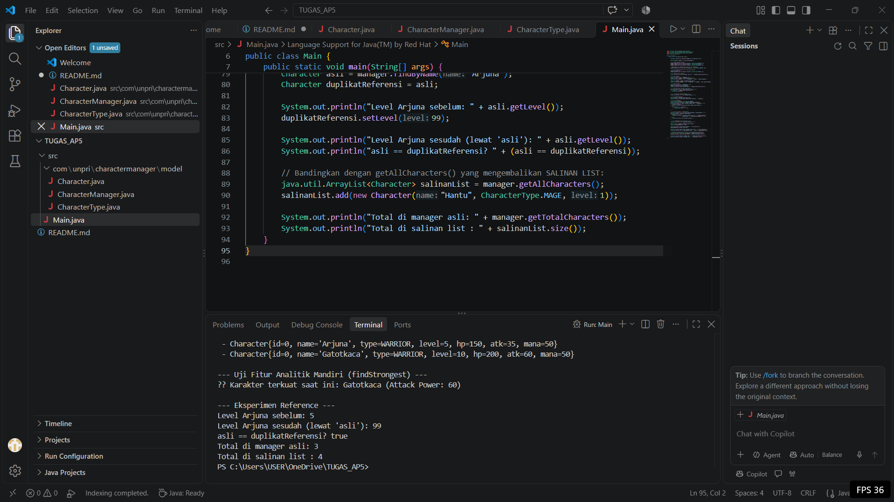

 # Character Manager - TP5 (Java Visual SIH-6406)

Character Manager merupakan aplikasi berbasis konsol yang dibuat menggunakan bahasa pemrograman Java untuk mengelola data karakter dalam sebuah game, seperti Warrior, Mage, Archer, dan Healer. Proyek ini menerapkan beberapa konsep Object-Oriented Programming (OOP), meliputi enkapsulasi, penggunaan enum, konstruktor dengan parameter berbeda, serta validasi data untuk menjaga konsistensi informasi karakter.

# Bagian C — Alasan Penambahan Fitur Mandiri (findStrongest)

Pada class CharacterManager, ditambahkan sebuah method mandiri bernama findStrongest(). Method ini berfungsi untuk memeriksa seluruh objek karakter yang tersimpan di dalam ArrayList<Character>, kemudian menentukan dan mengembalikan karakter dengan nilai attackPower paling tinggi.

Alasan dan Penerapan Konsep OOP

1. Fungsi Analisis Karakter

Fitur findStrongest() berguna untuk mengetahui karakter yang memiliki kekuatan serangan tertinggi. Informasi tersebut dapat dimanfaatkan untuk menampilkan statistik karakter, menentukan peringkat kekuatan, maupun mendukung pengembangan fitur pertarungan dalam game.

2. Penanganan Kondisi Daftar Kosong

Method ini juga memperhatikan kondisi ketika belum ada karakter yang tersimpan. Apabila characterList kosong, method akan mengembalikan null. Dengan demikian, program tidak mencoba mengambil elemen pertama dari daftar kosong yang dapat menyebabkan IndexOutOfBoundsException.

3. Enkapsulasi dan Penggunaan Reference

Dalam penerapannya, atribut characterList menggunakan modifier private, sehingga daftar karakter internal hanya dapat diakses secara langsung dari dalam class CharacterManager. Pengelolaan data dilakukan melalui method yang telah disediakan.

Method findStrongest() mengembalikan reference menuju objek Character dengan nilai attackPower tertinggi, atau null apabila daftar tidak memiliki karakter. Oleh karena itu, meskipun daftar internal tetap terlindungi, objek yang dikembalikan masih dapat dimodifikasi melalui reference tersebut. Hal ini menunjukkan bahwa perlindungan terhadap struktur daftar tidak selalu berarti objek di dalamnya tidak dapat diubah.

## Screenshot Hasil Program

## Struktur Folder Proyek

AP6_Tugas/
├── Screenshot 2026-10-17 035721.png
├── README.md
└── src/
    ├── Main.java
    └── com/
        └── unpri/
            └── charactermanager/
                └── model/
                    ├── Character.java
                    ├── CharacterManager.java
                    └── CharacterType.java

Nama : Johannes Noel Simbolon
Nim : 253303621218
Kelas : Semester 3 Pagi A
Link Google Docs :https://docs.google.com/document/d/1TD1rJMfyqa7vdwLatRFIV9yvvKBhQBPaSOEXand6GhY/edit?usp=sharing